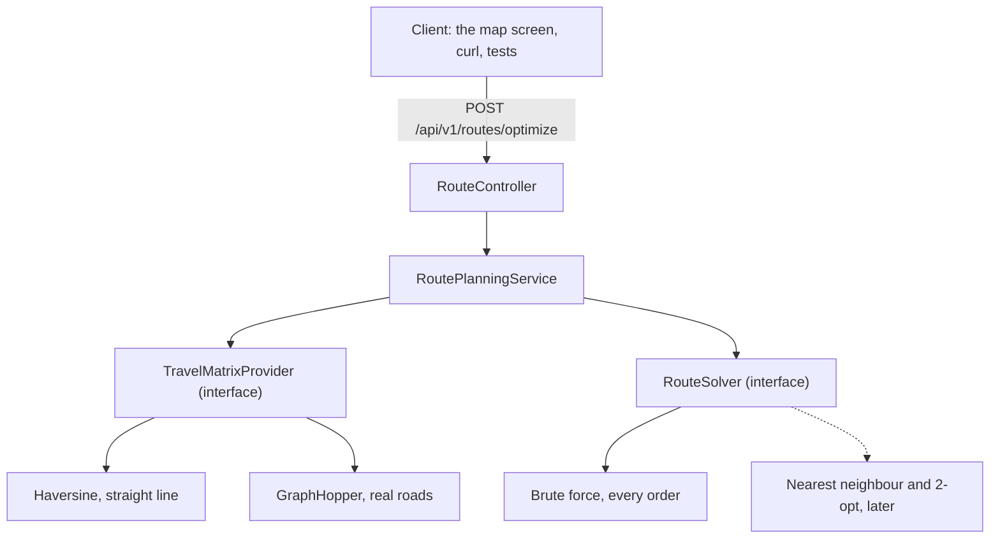
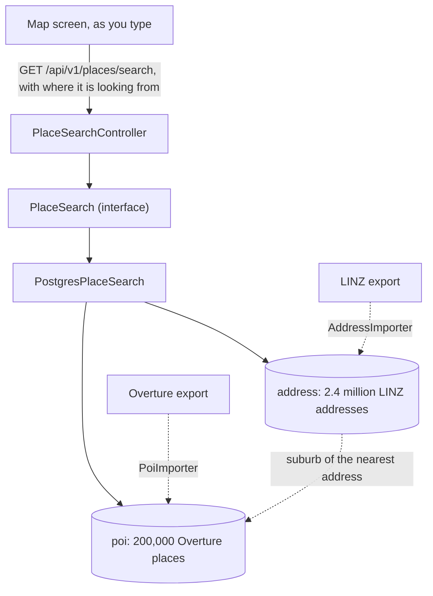
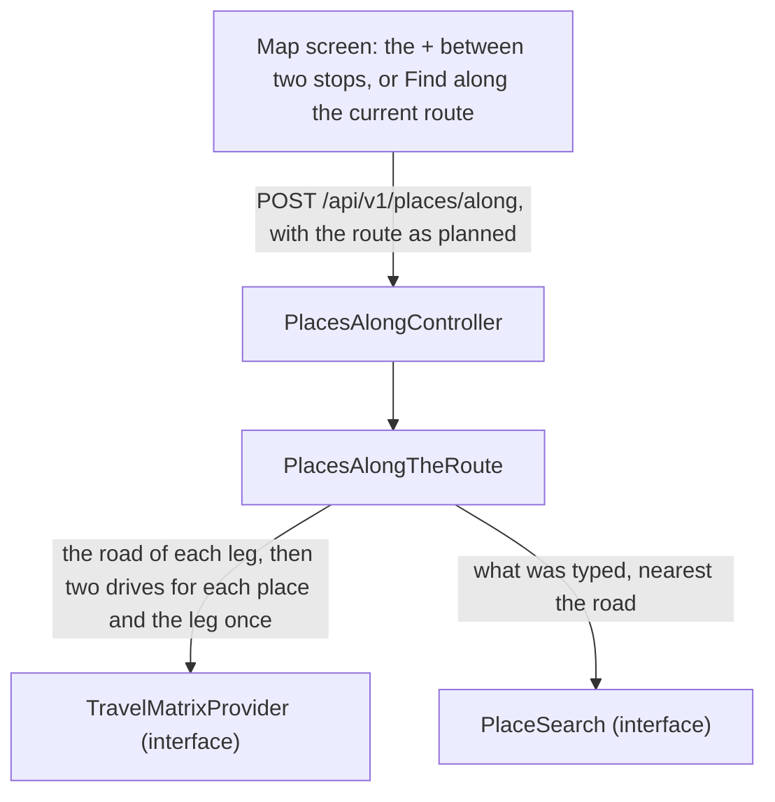

# Architecture

How the pieces fit together, and the two decisions that keep the later steps cheap.

## Request flow

Dotted lines are not built yet. Exactly one distance provider is active, chosen by `routeplanner.routing.provider` in `application.yaml`.

1. The controller takes JSON, validates it, and turns it into domain objects.
2. The service asks a matrix provider for travel figures between every pair of places.
3. The service turns those figures into a cost matrix. Cost means distance. When the request asks for the fastest order, it means driving time. When it asks for the least fuel, it means the litres the vehicle sent uses up for good.
4. The solver returns the cheapest order it can find.
5. The service builds the answer: the ordered stops, each leg with its road and its turns, and the totals.

## Components

| Package | Responsibility |
| --- | --- |
| `api` | HTTP only. Controller, request and response records, validation, error handling |
| `planning` | The domain. Cost matrices, solvers, the resulting plan. Plain Java, no Spring annotations |
| `distance` | Where travel figures come from. The provider interface and its implementations, and the rule that turns the heights along a drive into a climb |
| `address` | LINZ addresses: the table and its importer |
| `poi` | Named places from Overture Maps: the table and its importer |
| `search` | Finds addresses and named places from what was typed. The `PlaceSearch` interface and its PostgreSQL implementation |
| `along` | Places to stop at on the way along a planned route, each with what it adds to its leg |
| `saved` | Places somebody saved under a name: the JPA entity, its repository, and the rules about names |
| `vehicle` | The vehicle the planner works out fuel for: one row, entered by hand or found in the register |
| `cars` | Petrol cars from NZTA's Motor Vehicle Register: the table, its importer, and the lists a driver finds a car in |

Nothing in `planning` knows about HTTP, and nothing in `api` knows how distances are calculated.

## The two seams

**Travel figures arrive through an interface.** The service never calls haversine or GraphHopper itself. At step 3 a second implementation replaced straight lines with real driving distances, and the service, the solver and the controller were not touched.

The interface hands back a whole matrix rather than one pair at a time, so an engine that works out many places to many in one pass can fill it that way. The GraphHopper provider fills it one drive at a time, every ordered pair in turn: 110 drives for a start and ten stops.

A few drives can be asked for one at a time, `driveBetween`, when every pair would be waste: what a stop on the way adds to a leg is two drives less one. The GraphHopper provider measures a drive asked for alone as it measures one in the matrix, so the two can be set against each other.

The legs of the answer are asked for again, one by one, for their `Directions`: the road's shape, for the map, and its turns, for following it. GraphHopper works the turns out from OpenStreetMap along with the road. `TurnsFromTheEngine` keeps what the engine knows of each: which way, the road, where the signs point, the motorway exit. For a turn onto a road the map leaves unnamed, an on-ramp most often, it takes the road the stretch after it mostly follows, from the names the engine gives along the drive. The words are left to the screen, `turns.ts`.

**The solver minimises a cost matrix without knowing what cost means.** Distance, seconds or litres fill it. That turns "fastest or most fuel-efficient" into a decision about how the matrix is built, not a rewrite of the algorithm.

The fastest order is one use of it. Its table is the driving time of each drive. The shortest order is still worked out, so the answer can say what was given up for what. The order found over the times is taken when it saves a minute or more over the shortest, and the shortest order is the answer otherwise.

The least fuel is the other. Its table is the litres each drive uses up for good in the vehicle sent, by `FuelUse`: what it takes on the level, its town figure for its kilometres in town and its open-road figure for the rest, and what its steep descents brake away. A climb is left out, since the car keeps it as height. Over a round trip that adds up to the fuel the trip takes. A one-way trip is not drawn to its lowest stop, which would only leave the car lower. The order found is taken when it saves a hundredth of a litre that way and as driven, and the shortest order is the answer otherwise. On straight lines, which have neither town roads nor hills, the fuel goes with the distance, and the shortest order already takes the least.

Asked for one of the two, the service finds the other as well, by its own rule against the same shortest order: the fastest beside the least fuel, and the least fuel beside the fastest when a vehicle is sent. The answer carries its totals, so the screen can say what the other comes to. It costs one more search over the same matrix, and no more drives.

How much of each drive is in town comes with the matrix, `kmInTown`. The GraphHopper provider asks the engine for the speed it drives each stretch at, and counts a stretch at 60 km/h or less as town. Each leg of the answer carries its share, and the fuel of the plan is worked out from it.

**A stop kept in its place is a rule about the order, not about the cost.** The solver is told which stops must be visited at the turn they were entered in, and it only ever builds the orders that respect that. It still knows nothing about why. Keeping a stop also makes the work smaller: ten stops with three kept is 5,040 orders to compare rather than 3.6 million.

## Place search

A second, separate flow. It turns typing into a pin, and never touches the planning flow above.

Dotted lines happen at import time, not on a search.

**Two datasets, each used for what it is the authority on.** LINZ publishes every New Zealand address but no names. Overture Maps publishes named places but is no address register. They meet in two places: one query searches both tables, and each place borrows its suburb from the nearest LINZ address, because Overture usually gives only the city.

**Found on everything, ranked on what people call it.** A place matches if the typed words appear anywhere in its searchable text. It is then scored on how well the words appear in its address, for an address, or in its name, for a named place. Scoring a business on its street address as well puts "McDonalds Road" ahead of McDonald's.

**A branch is as good a match as the brand.** 181 places have a name that starts with New World, and 27 of them are called just "New World". Measuring how alike the typing and the whole name are put those 27 first, from all over the country, and "New World Remuera" behind them for the word nobody typed. So the score asks a different question: do the words appear in the name together, as whole words? Every branch then scores the same, and something else is free to choose between them.

**A word in between costs nothing, unless the words name something.** Nothing is called Auckland Hospital. The hospital is Auckland City Hospital, and as a run of words "City" cost as much as a word nobody typed, so the foundation, the wards and the post boxes called Auckland Hospital Something all came first. So a name that holds the words in the order typed is also scored on each word on its own, and the better of the two counts. "the warehouse" is different. Places are called just that, and The Rug Warehouse is another shop. When anything found is called just the words typed, with or without the spaces between them, the words count only together, as before. The words on their own are looked for in the name and not in the suburb, or "the parnell" would match everything in Parnell with "The" in its name.

**Nearest first.** That something is distance. A search can say where it is looking from, and the score then falls gently the farther away a place is: to three quarters at 50 km, and never below half. Gently, because distance is there to choose between equal matches, not to promote a poor match for being close. The map screen sends where you are, if the browser shared that when the page opened. If it did not, it sends the start of the trip, and until there is a start, the middle of the map. The browser is asked when the page opens and listened to for half a minute, because its first answer is often its roughest: a phone answers at once from the network and again seconds later from GPS. A later answer is taken only if the browser itself rates it better, and never over a pin somebody has dragged to the right spot. After that half minute nothing follows the device. The position is sent rounded to about 100 metres. One consequence: with your location shared, a trip planned for another town still gets results near you, until the town is typed as well.

**Both sides are simplified before they are compared.** A database function, `searchable`, drops accents and apostrophes. Each table stores the simplified text in a generated column with a trigram index, and the search runs what was typed through the same function. One address in eight has a macron, and a search that typed that word on an ordinary keyboard, without the macron, used to find nothing.

**Some words are written two ways.** LINZ writes Saint Heliers in full and St Lukes Road short, and Overture writes most streets short. So what was typed is spelled every way it may be written, "mt eden rd" four ways, and a place is found when it matches any of them. It is then scored on the spellings it holds, and the best one counts, so 12 Bassett Road ranks the same whether "road" or "rd" was typed. An abbreviation that is the beginning of its word needs no help when it is the one typed: "ave" already finds Avenue, as any unfinished word does. The word typed in full always does, since "avenue" is nowhere in "Ave". An abbreviation looked for on behalf of a word typed in full has to stand as a word of its own, or "saint" would find every Stanley Street. The index cannot find a word that short, so that is done only when something else typed narrows the search.

**In a suburb is not the same as named for it.** A place takes its suburb from LINZ, so everything in Saint Heliers matches "st heliers" once that is read as Saint. A place with a word in its name that begins with the first word typed keeps its whole score, and one found only by its suburb or its street keeps four fifths, the same step down as an address that merely contains the words. A place whose name and suburb lack a word typed keeps four fifths as well, having been found partly by the street it is on: "bank street whangarei" reads "street" as St too, and so found a hairdresser with Bank in its name on Robert St.

**A flat that is not listed falls back to its building.** LINZ lists the flats of some buildings and not of others, always before a slash. An address typed with a flat that finds nothing is searched again: as LINZ would write it, if the flat was typed in words, and then without the flat. It is another search and not a looser pattern, so a place that holds everything typed is never pushed down by one that holds part of it.

**The work for one search is bounded.** Each table hands over at most 5,000 matches to be ranked. "road" matches 850,000 addresses, and scoring them all took over four seconds. A search specific enough to be useful matches far fewer rows than the cap. When a search says where it is looking from, those 5,000 should be the nearest ones, so up to 20,000 matches are measured for distance first. Measuring is cheap. Scoring is what costs.

## Stops on the way

Once a trip is planned, the search box on the map screen finds a place to stop at between two stops, from the "+" between them in the list, or anywhere along the route, from the box under it. A third flow, built on the two above.

**Near is found by the search, and what a stop adds by driving.** The search ranks places by how near they are to the road of a leg, the line its points draw, as it ranks them by how near they are to a point. The road is thinned to a point every 100 m first, since the engine gives one at every bend and the search measures each place against every point. Near is not the same as on the way. A shop across a motorway can be a long way round. So the first twelve are each driven to from the start of their leg and on to its end, and given back in the order of the time they add.

**The list takes the order of the plan.** When a plan comes back, the list of stops changes to the order it drives, as one change that undo takes back. Two stops side by side are then a leg of the plan, which is what the "+" between them needs. A label nobody changed moves with its turn, so the plan is renamed to match: a pin finds its turn in the plan by name. A plan is held against the order the list had when it was asked for, and after the first plan that is the order of the one before.

**A stop on the way keeps the order the plan had.** The screen puts the place between the two stops it was found between, and plans the trip again in the order of the plan with every stop kept at its turn, which leaves one order to take. Keeping a stop in its place already said all of that, so planning needed nothing new. The answer compared no orders, so the screen leaves out what it holds a plan against: the order you clicked, the saving and the other choice.

## Saved places

A third flow, and the first one that writes. A place is saved under a name, listed, and removed.

**JPA here, SQL in search.** Search reads two tables that share no class, so it is one SQL statement. A saved place is one table, written and read a row at a time. That is what JPA is for, so `SavedPlace` is an entity and its repository is an interface with no code behind it.

**The table keeps names apart, not the code.** A name can be saved once, whatever the capitals, because a unique index on the lower-cased name says so. The service does not look first and save second: two requests arriving together would both find the name free. It saves, and turns the database's refusal into an error that says which name.

**The list is sorted in Java.** By name, with capitals and macrons counting for nothing until two names are otherwise the same. A database orders text by the rules it was created with, and those differ from one machine to the next.

**A saved place and a pin are the same spot when their positions match.** One is always copied from the other, so the numbers agree to the last digit. That is how the map screen shows "saved" beside a place, and knows a saved place, or a place found by searching, is already in the trip. Planning is untouched: it still takes positions, and never a saved place's id.

**The list is private.** It is likely to hold a home address, and the app has no login. Its answer is marked not to be stored, and what keeps strangers away from it is the next section.

## The vehicle

The second entity, and a table of one row: one driver, one vehicle. Its id is always 1, and the table checks that, so saving a vehicle replaces the one there was and a second row cannot happen. `Vehicles` hands JPA a vehicle with that id, and JPA reads the row first and then inserts or updates it.

It is entered by hand, with its size in place of the weight and what its dashboard shows in L/100 km, or found in the register below, with its make, model, year and engine. The table refuses a vehicle that is both or neither. A car found there goes by the register's figure unless the dashboard's is given, and the row says which with `figure_from`, so the screen can say when the figure is the official one. The ranges are checked three times: on the screen before it is sent, by the API, and by the table.

Its weight is not stored. It is worked out when the vehicle is read: from the size for a vehicle entered by hand, and for a car found in the register from the gross mass the register gives it, by `CarWeights`. So a register imported again weighs the car again. Its figures in town and on the open road are worked out the same way: its one figure split as the register splits the car's, or as `FuelUse` splits a figure on its own.

A saved car keeps its own copy of how the register describes it, not a link to a row there. Each import replaces the register's table whole, and the vehicle is not touched.

## Cars from the register

NZTA's Motor Vehicle Register lists every vehicle in the country, about six million, with the fuel figures of the test each was approved with. `scripts/export-nzta-cars.sh` asks NZTA's own service to add up the petrol cars by make, model, year, engine to the tenth of a litre, and whether each was sold new here or imported used, and to give the middle figure of each. The whole register at once is more than the service adds up before it gives up, so it goes one make at a time. A car listed fewer than ten times is left out, which is where the register's mistakes are. The file holds about 9,300 rows.

`CarImporter` loads that file into `car_variant` when asked, in one transaction, as the other importers do. `CarRegister` reads it through `JdbcClient`, one list per step a driver takes: the makes, the models of a make, the years of a model, the engines of a year. A driver is not asked whether the car was sold new here or imported used, so each engine is listed once, with the figure of whichever of the two has more cars.

The table also keeps the gross mass and the seats, which give a car's weight for the hills, and the urban and extra-urban figures, which split its fuel between town and the open road. A used import's gross mass is the car and 55 kg a seat, where a car sold new here has the most its maker allows loaded, so `CarWeights` reads the two differently.

## One app

Working on the code, there are two servers. Vite serves the map screen and passes `/api` on to the API. To use the planner there is one. The Maven profile `with-screen` builds the screen into the jar, and Spring serves it from the same port as the API. Either way the browser sees one origin, so there is no CORS setup.

**It answers only the machine it runs on.** The app has no login, so the address it listens on is the only lock it has, and that address is 127.0.0.1. Using it from another device takes something in front of it with a lock of its own, such as a private tunnel. That also supplies the https a browser asks for before it shares a location. `SERVER_ADDRESS=0.0.0.0` makes the app listen on every network the machine is on, for a server that keeps its own proxy in front. A test starts the app on a real port and tries every other address of the machine.

**The browser asks every time whether the screen has changed.** Left to itself a browser can go on showing an old build for hours after a new one is running. Asking costs a few small requests and no download when nothing changed.

**Text is compressed on the way out.** The screen is a third of the size to download, and a planned route with its road geometry a quarter.

## Units and limits

| Thing | Decision |
| --- | --- |
| Coordinates | WGS84 decimal degrees, the numbers Google Maps shows |
| Distance | Kilometres. Rounded to two decimals in responses only, never during calculation |
| Duration | Seconds. Driving time on clear roads, with nothing added for a stop. Absent on straight lines, which say how far and not how long |
| Climb and descent | Metres, whole in responses. Each is added along the road, counting only where the road turns by 10 m or more. Absent unless the roads were read with their heights |
| Stops per request | 10 at most. Checking every order grows by factorial, so 10 stops is already 3.6 million |
| Start | Required. Returning to it is optional |

## Two things real roads brought with them

**Distances stopped being symmetric.** A straight line from A to B equals the line back. A drive does not, because of one-way streets and motorway ramps, so every ordered pair is calculated separately rather than mirroring half the table.

**Some places cannot be reached at all.** A coordinate away from any street, on an airfield or inside a park, has nothing to snap to. That is not a broken request and not a broken server, so it answers 422 naming the place, rather than failing with a 500.

## What heights brought with them

The map has no heights in it. GraphHopper can read them off a grid of the ground while it prepares its graph, and that is a setting, off unless asked for, because switching it on fetches 480 MB.

**Two graphs, each in its own folder.** A graph prepared with heights and one prepared without cannot be read as each other. So the setting chooses the folder as well, and changing it loses neither.

**The engine's settings had to change for hills to survive.** Left alone it drops any point a road keeps its shape without, judging by the map alone, and the top of a hill on a straight road is such a point. It also knows nothing of the ground between two bends. So a height is taken every 60 m along a straight stretch, and a point is kept when dropping it would move the road up or down by more than a metre. Each needs the other.

**The engine's own totals for climb are not used.** It adds up every rise and fall between neighbouring points. The grid is the ground and not the road, and in whole metres, so that sum came to 113 m of climbing on 19 km of level road. `HeightProfile` evens the heights out over 150 m of road and counts a rise or a dip only when the road turns by 10 m or more. It is plain Java and its two settings can be changed without preparing the graph again. It also keeps each descent it counts on its own, with the road it falls over, because how steep a descent is decides how much fuel it gives back. `docs/api.md` has what was measured.

**Distance is still measured on the map.** With heights the engine measures every road along its slope, wobble of the grid included, which lengthened a gorge road by 1.3% over what it measures on the map. Distance is what the solver minimises, so it is taken off the map either way and switching heights on does not move it. Driving time is left as the engine gives it, and comes out a fraction longer.

**A pin knows how high it stands.** With heights on, a pin's popup says how high the ground is there. `HeightFiles` reads the height files with the reader the engine used for the roads, so a pin and the road beside it are read alike. That reader fetches a file it does not find, so `HeightFiles` looks for the file first, and hands the reader a downloader that refuses. It keeps the heights it unpacks in memory, at most four files of 26 MB, where the reader would write them to disk beside each file.

## Deliberately absent

Traffic data, because OpenStreetMap has none and live traffic costs money. Several drivers, time windows and vehicle capacity, until the single driver version is stable. Authentication. Saved places are private, and what keeps them so is that the app answers only the machine it runs on, so anything put in front of it has to bring a lock of its own. Guidance while driving. The turns of each leg are written out, and the driving itself is handed to Google Maps.

## What each step changes

| Step | Change to this picture |
| --- | --- |
| 2 | **Done.** LINZ addresses and Overture places in PostgreSQL behind a `PlaceSearch` interface, mirroring how distances work, with an endpoint the map screen calls. Saved places are a JPA entity behind three endpoints. The planning flow above was untouched by both |
| 3 | **Done.** A second `TravelMatrixProvider` backed by GraphHopper, chosen by configuration. The service, the solver and the controller were not touched, which is what the seam was for. It gives the time of each drive as well as its length, and with heights switched on how much it climbs and descends. The order is chosen for distance unless the request asks otherwise |
| 4 | **Done.** A React app in `frontend/`, calling the same endpoint. The backend did not change. In development Vite proxies `/api` to port 8080, so there is no CORS setup. To use it, the screen is built into the jar and the API serves both |
| 5 | **Begun.** The vehicle is saved in the planner: entered by hand with what its dashboard shows and its size, or found in NZTA's register by make, model, year and engine. Its fuel use and its weight arrive with the request. They do not reach the matrix provider yet, because nothing there reads them |
| 6 | **Done.** Two more ways to fill the cost matrix: driving time, when the request asks for the fastest order, and litres, when it asks for the least fuel. The fuel each leg takes is worked out after the order is chosen, by `FuelEstimate`: by `FuelUse`, the vehicle's town figure for the leg's kilometres in town and its open-road figure for the rest, and what each climb costs and each descent gives back, once the roads have heights and the weight is known. Asked for one, the answer gives the other beside it, with what each comes to |
