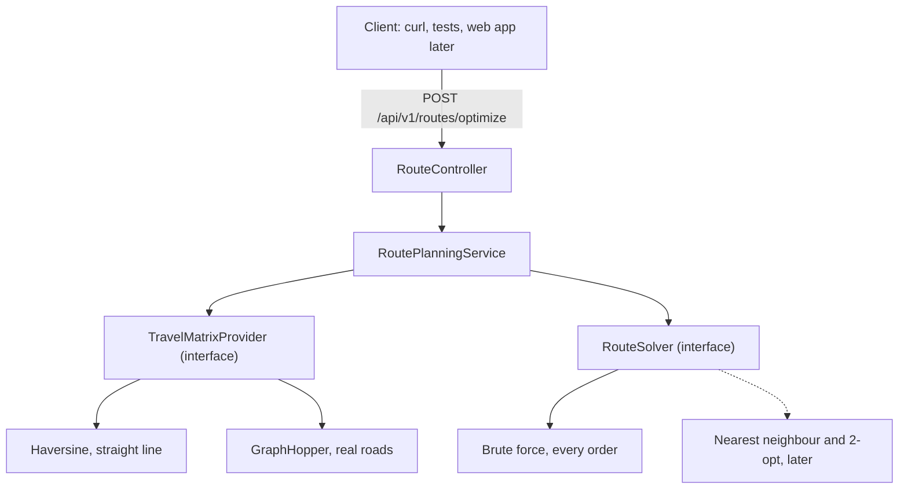
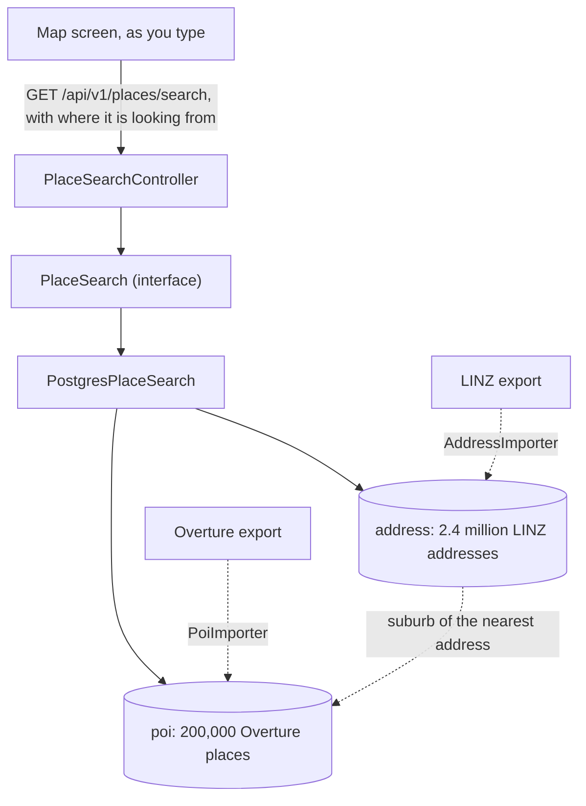

# Architecture

How the pieces fit together, and the two decisions that keep the later steps cheap.

## Request flow

Dotted lines are not built yet. Exactly one distance provider is active, chosen by `routeplanner.routing.provider` in `application.yaml`.

1. The controller takes JSON, validates it, and turns it into domain objects.
2. The service asks a matrix provider for travel figures between every pair of places.
3. The service turns those figures into a cost matrix. Cost means distance. When the request asks to factor in road climbs, it means distance with the climb counted as extra road.
4. The solver returns the cheapest order it can find.
5. The service builds the answer: the ordered stops, each leg, and the totals.

## Components

| Package | Responsibility |
| --- | --- |
| `api` | HTTP only. Controller, request and response records, validation, error handling |
| `planning` | The domain. Cost matrices, solvers, the resulting plan. Plain Java, no Spring annotations |
| `distance` | Where travel figures come from. The provider interface and its implementations, and the rule that turns the heights along a drive into a climb |
| `address` | LINZ addresses: the table and its importer |
| `poi` | Named places from Overture Maps: the table and its importer |
| `search` | Finds addresses and named places from what was typed. The `PlaceSearch` interface and its PostgreSQL implementation |
| `saved` | Places somebody saved under a name: the JPA entity, its repository, and the rules about names |

Nothing in `planning` knows about HTTP, and nothing in `api` knows how distances are calculated.

## The two seams

**Travel figures arrive through an interface.** The service never calls haversine or GraphHopper itself. At step 3 a second implementation replaces straight lines with real driving distances, and the service, the solver and the controller stay untouched.

The interface hands back a whole matrix rather than one pair at a time, because routing engines calculate many-to-many distances in a single pass. Asking pair by pair would be far slower once real roads arrive.

**The solver minimises a cost matrix without knowing what cost means.** Distance fills it today. Seconds or litres can fill it later. That turns "fastest or most fuel-efficient" into a decision about how the matrix is built, not a rewrite of the algorithm.

Factoring in road climbs was the first use of it. A second table counts every metre a drive climbs as 10 m of road, and the same solver is run over it. The shortest order is still worked out, so the answer can say what was given up for what. The 10 is `routeplanner.planning.road-metres-per-metre-climbed`.

**A stop kept in its place is a rule about the order, not about the cost.** The solver is told which stops must be visited at the turn they were entered in, and it only ever builds the orders that respect that. It still knows nothing about why. Keeping a stop also makes the work smaller: ten stops with three kept is 5,040 orders to compare rather than 3.6 million.

## Place search

A second, separate flow. It turns typing into a pin, and never touches the planning flow above.

Dotted lines happen at import time, not on a search.

**Two datasets, each used for what it is the authority on.** LINZ publishes every New Zealand address but no names. Overture Maps publishes named places but is no address register. They meet in two places: one query searches both tables, and each place borrows its suburb from the nearest LINZ address, because Overture usually gives only the city.

**Found on everything, ranked on what people call it.** A place matches if the typed words appear anywhere in its searchable text. It is then scored on how well the words appear in its address, for an address, or in its name, for a named place. Scoring a business on its street address as well puts "McDonalds Road" ahead of McDonald's.

**A branch is as good a match as the brand.** 181 places have a name that starts with New World, and 27 of them are called just "New World". Measuring how alike the typing and the whole name are put those 27 first, from all over the country, and "New World Remuera" behind them for the word nobody typed. So the score asks a different question: do the words appear in the name together, as whole words? Every branch then scores the same, and something else is free to choose between them.

**Nearest first.** That something is distance. A search can say where it is looking from, and the score then falls gently the farther away a place is: to three quarters at 50 km, and never below half. Gently, because distance is there to choose between equal matches, not to promote a poor match for being close. The map screen sends where you are, if the browser shared that when the page opened. If it did not, it sends the start of the trip, and until there is a start, the middle of the map. The browser is asked when the page opens and listened to for half a minute, because its first answer is often its roughest: a phone answers at once from the network and again seconds later from GPS. A later answer is taken only if the browser itself rates it better, and never over a pin somebody has dragged to the right spot. After that half minute nothing follows the device. The position is sent rounded to about 100 metres. One consequence: with your location shared, a trip planned for another town still gets results near you, until the town is typed as well.

**Both sides are simplified before they are compared.** A database function, `searchable`, drops accents and apostrophes. Each table stores the simplified text in a generated column with a trigram index, and the search runs what was typed through the same function. One address in eight has a macron, and a search that typed that word on an ordinary keyboard, without the macron, used to find nothing.

**Some words are written two ways.** LINZ writes Saint Heliers in full and St Lukes Road short, and Overture writes most streets short. So what was typed is spelled every way it may be written, "mt eden rd" four ways, and a place is found when it matches any of them. It is then scored on the spellings it holds, and the best one counts, so 12 Bassett Road ranks the same whether "road" or "rd" was typed. An abbreviation that is the beginning of its word needs no help when it is the one typed: "ave" already finds Avenue, as any unfinished word does. The word typed in full always does, since "avenue" is nowhere in "Ave". An abbreviation looked for on behalf of a word typed in full has to stand as a word of its own, or "saint" would find every Stanley Street. The index cannot find a word that short, so that is done only when something else typed narrows the search.

**In a suburb is not the same as named for it.** A place takes its suburb from LINZ, so everything in Saint Heliers matches "st heliers" once that is read as Saint. A place with a word in its name that begins with the first word typed keeps its whole score, and one found only by its suburb or its street keeps four fifths, the same step down as an address that merely contains the words.

**A flat that is not listed falls back to its building.** LINZ lists the flats of some buildings and not of others, always before a slash. An address typed with a flat that finds nothing is searched again: as LINZ would write it, if the flat was typed in words, and then without the flat. It is another search and not a looser pattern, so a place that holds everything typed is never pushed down by one that holds part of it.

**The work for one search is bounded.** Each table hands over at most 5,000 matches to be ranked. "road" matches 850,000 addresses, and scoring them all took over four seconds. A search specific enough to be useful matches far fewer rows than the cap. When a search says where it is looking from, those 5,000 should be the nearest ones, so up to 20,000 matches are measured for distance first. Measuring is cheap. Scoring is what costs.

## Saved places

A third flow, and the first one that writes. A place is saved under a name, listed, and removed.

**JPA here, SQL in search.** Search reads two tables that share no class, so it is one SQL statement. A saved place is one table, written and read a row at a time. That is what JPA is for, so `SavedPlace` is an entity and its repository is an interface with no code behind it.

**The table keeps names apart, not the code.** A name can be saved once, whatever the capitals, because a unique index on the lower-cased name says so. The service does not look first and save second: two requests arriving together would both find the name free. It saves, and turns the database's refusal into an error that says which name.

**The list is sorted in Java.** By name, with capitals and macrons counting for nothing until two names are otherwise the same. A database orders text by the rules it was created with, and those differ from one machine to the next.

**A saved place and a pin are the same spot when their positions match.** One is always copied from the other, so the numbers agree to the last digit. That is how the map screen shows "saved" beside a place, and knows a saved place is already in the trip. Planning is untouched: it still takes positions, and never a saved place's id.

**The list is private.** It is likely to hold a home address, and the app has no login. Its answer is marked not to be stored, and what keeps strangers away from it is the next section.

## One app

Working on the code, there are two servers. Vite serves the map screen and passes `/api` on to the API. To use the planner there is one. The Maven profile `with-screen` builds the screen into the jar, and Spring serves it from the same port as the API. Either way the browser sees one origin, so there is no CORS setup.

**It answers only the machine it runs on.** The app has no login, so the address it listens on is the only lock it has, and that address is 127.0.0.1. Using it from another device takes something in front of it with a lock of its own, such as a private tunnel. That also supplies the https a browser asks for before it shares a location. `SERVER_ADDRESS=0.0.0.0` makes the app listen on every network the machine is on, for a server that keeps its own proxy in front. A test starts the app on a real port and tries every other address of the machine.

**The browser asks every time whether the screen has changed.** Left to itself a browser can go on showing an old build for hours after a new one is running. Asking costs a few small requests and no download when nothing changed.

**Text is compressed on the way out.** The screen is a third of the size to download, and a planned route with its road geometry a quarter.

## Units and limits

| Thing | Decision |
| --- | --- |
| Coordinates | WGS84 decimal degrees, the numbers Google Maps shows |
| Distance | Kilometres. Rounded to two decimals in responses only, never during calculation |
| Duration | Seconds. Driving time on clear roads, with nothing added for a stop. Absent on straight lines, which say how far and not how long |
| Climb and descent | Metres, whole in responses. Each is added along the road, counting only where the road turns by 10 m or more. Absent unless the roads were read with their heights |
| Stops per request | 10 at most. Checking every order grows by factorial, so 10 stops is already 3.6 million |
| Start | Required. Returning to it is optional |

## Two things real roads brought with them

**Distances stopped being symmetric.** A straight line from A to B equals the line back. A drive does not, because of one-way streets and motorway ramps, so every ordered pair is calculated separately rather than mirroring half the table.

**Some places cannot be reached at all.** A coordinate away from any street, on an airfield or inside a park, has nothing to snap to. That is not a broken request and not a broken server, so it answers 422 naming the place, rather than failing with a 500.

## What heights brought with them

The map has no heights in it. GraphHopper can read them off a grid of the ground while it prepares its graph, and that is a setting, off unless asked for, because switching it on fetches 480 MB.

**Two graphs, each in its own folder.** A graph prepared with heights and one prepared without cannot be read as each other. So the setting chooses the folder as well, and changing it loses neither.

**The engine's settings had to change for hills to survive.** Left alone it drops any point a road keeps its shape without, judging by the map alone, and the top of a hill on a straight road is such a point. It also knows nothing of the ground between two bends. So a height is taken every 60 m along a straight stretch, and a point is kept when dropping it would move the road up or down by more than a metre. Each needs the other.

**The engine's own totals for climb are not used.** It adds up every rise and fall between neighbouring points. The grid is the ground and not the road, and in whole metres, so that sum came to 113 m of climbing on 19 km of level road. `HeightProfile` evens the heights out over 150 m of road and counts a rise or a dip only when the road turns by 10 m or more. It is plain Java and its two settings can be changed without preparing the graph again. `docs/api.md` has what was measured.

**Distance is still measured on the map.** With heights the engine measures every road along its slope, wobble of the grid included, which lengthened a gorge road by 1.3% over what it measures on the map. Distance is what the solver minimises, so it is taken off the map either way and switching heights on does not move it. Driving time is left as the engine gives it, and comes out a fraction longer.

## Deliberately absent

Traffic data, because OpenStreetMap has none and live traffic costs money. Several drivers, time windows and vehicle capacity, until the single driver version is stable. Authentication. Saved places are private, and what keeps them so is that the app answers only the machine it runs on, so anything put in front of it has to bring a lock of its own. Turn by turn navigation, which is handed to Google Maps or Waze.

## What each step changes

| Step | Change to this picture |
| --- | --- |
| 2 | **Done.** LINZ addresses and Overture places in PostgreSQL behind a `PlaceSearch` interface, mirroring how distances work, with an endpoint the map screen calls. Saved places are a JPA entity behind three endpoints. The planning flow above was untouched by both |
| 3 | **Done.** A second `TravelMatrixProvider` backed by GraphHopper, chosen by configuration. The service, the solver and the controller were not touched, which is what the seam was for. It gives the time of each drive as well as its length, and with heights switched on how much it climbs and descends. The order is chosen for distance unless the request asks otherwise |
| 4 | **Done.** A React app in `frontend/`, calling the same endpoint. The backend did not change. In development Vite proxies `/api` to port 8080, so there is no CORS setup. To use it, the screen is built into the jar and the API serves both |
| 5 | Vehicle details arrive in the request and reach the matrix provider |
| 6 | **Begun.** A second way to fill the cost matrix: distance with the climb counted as extra road, when the request asks to factor in road climbs. Fuel instead of distance is still to come, and needs the vehicle of step 5 |
